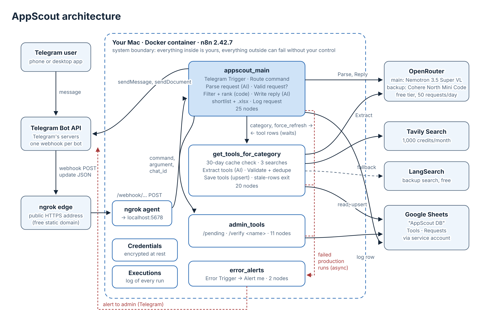

# AppScout

A Telegram bot that helps small teams choose a SaaS tool. You send one sentence, for example
`/compare CRM for 10 people under 20 euros per user, needs lead scoring`, and it replies with a ranked
shortlist and the full comparison table as an Excel file. Every tool has its source link and a
[verified] or [unverified] label.

**The need, in one sentence:** a small team choosing a CRM, a project-management or an email-marketing
tool today opens ten tabs of "best tools" articles and copies prices into a spreadsheet by hand,
in mixed units (per user, per contact, monthly, yearly, dollars, euros).

Course project, No Code (n8n and system design). Self-hosted n8n 2.42.7 in Docker, on free tiers only.

## Architecture



- **Telegram → ngrok → n8n.** Telegram delivers each message by webhook to a public HTTPS address
  (an ngrok static domain), which forwards it to n8n on the laptop (port 5678).
- **Four workflows** (in `workflows/`):
  - `appscout_main` (25 nodes): routes every message, turns the request into criteria with AI
    (Parse request), gets the tools, ranks them in code (Filter + rank), has AI write the reply
    (Write reply), sends the shortlist and the .xlsx, and logs the request.
  - `get_tools_for_category` (20 nodes, sub-workflow): returns a category's tools. If at least 5 rows
    were checked in the last 30 days, it answers from the Google Sheet (cache). Otherwise it searches
    with Tavily (LangSearch as backup), has AI extract the tools (backup model), validates and saves
    them. If the refresh fails, it returns the stored rows marked stale.
  - `admin_tools` (11 nodes, sub-workflow): `/pending` and `/verify`, only for the admin (checked on the
    Telegram user id in appscout_main).
  - `error_alerts` (2 nodes): the error workflow; sends the admin a Telegram alert with the workflow,
    node, error and execution link whenever a production run fails.
- **Database:** a private Google Sheet "AppScout DB" (tabs Tools and Requests), reached with a Google
  service account.
- **AI:** free models on OpenRouter (main `nvidia/nemotron-3.5-super-vl:free`, backup
  `cohere/north-mini-code:free`). AI only reads and writes text; filtering, ranking and validation are code.
- **Level:** scoped as level 2 in the proposal; the build adds level 3 features (two sub-workflows,
  fallbacks for every outside service, stored state with human verification, failure tests).

## Setup, from clone to running

Requirements: Docker Desktop, an ngrok account with a free static domain, a Telegram account,
and free accounts at OpenRouter, Tavily, LangSearch and Google Cloud.

1. **Clone and configure**
   ```bash
   git clone <this repo> appscout-n8n
   cd appscout-n8n
   cp .env.example .env
   ```
   Fill in `.env`:

   | Variable | What it is |
   |---|---|
   | `N8N_ENCRYPTION_KEY` | Encrypts every credential n8n stores. 64 hex characters: `openssl rand -hex 32`. Back it up: without it, stored credentials cannot be read. |
   | `PUBLIC_URL` | Your public HTTPS address, `https://<your static domain>/`. n8n registers the Telegram webhook from it. |

2. **Start n8n**
   ```bash
   docker compose up -d
   docker compose ps          # STATUS should be "Up"
   ```
   The image is pinned (`n8nio/n8n:2.42.7`) and the data lives in the named volume `n8n_data`, so it
   survives `docker compose down` and `up`. Never use `docker compose down -v` (it deletes the volume).

3. **Start the tunnel** (in its own Terminal window, left open)
   ```bash
   ngrok http --url=<your static domain> 5678
   ```

4. **Open n8n** at http://localhost:5678, create the owner account, and turn on 2FA
   (Settings → Personal).

5. **Create the five credentials** (Overview → Create → Credential):

   | Name | Type | Where the secret comes from |
   |---|---|---|
   | Telegram AppScout | Telegram API | @BotFather → `/newbot` |
   | OpenRouter AppScout | OpenRouter API | openrouter.ai → Keys (allow free endpoints in Settings → Privacy) |
   | Tavily header auth | Header Auth: `Authorization` = `Bearer <key>` | app.tavily.com |
   | LangSearch header auth | Header Auth: `Authorization` = `Bearer <key>` | langsearch.com |
   | Google Service Account | Google Service Account API (e-mail + private key) | Google Cloud: enable Sheets and Drive APIs, create a service account, add a JSON key |

6. **Create the Google Sheet** "AppScout DB" and share it with the service account's e-mail as Editor
   (General access: Restricted).
   - Tab **Tools** (16 columns): `tool_key, category, name, plan_name, price_per_user_month, currency,
     price_note, free_plan, key_features, integrations, best_for, source_url, status, verified_by,
     last_checked, notes`. Format columns A, B and O as Plain text.
   - Tab **Requests** (13 columns): `request_id, created_at, chat_id, username, request_text, category,
     team_size, budget_per_user_eur, must_haves, cache_hit, tools_returned, top_tools, outcome`.

7. **Import the workflows** from `workflows/` (Overview → Create → Import from file), then in each one:
   - choose your credentials in every node that uses one, and your sheet in every Google Sheets node;
   - type your own Telegram user id in **Admin?** (appscout_main) and **Alert me** (error_alerts);
   - ⋯ → Settings → Error Workflow: `error_alerts` (for the three other workflows).

8. **Publish in this order:** error_alerts → get_tools_for_category and admin_tools → appscout_main.
   Publishing appscout_main registers the Telegram webhook. After that, never click Execute workflow on
   appscout_main (it moves the webhook to the test address; fix: Unpublish, then Publish).

9. **Check:** send `/help` to the bot. A reply proves Telegram → ngrok → n8n → Telegram works.

## How to test

- **The bot:** the messages and expected replies are in [`tests/telegram_messages.md`](tests/telegram_messages.md).
- **The sub-workflows alone:** pin a mock input from `tests/` on the sub-workflow's trigger and click
  Execute workflow (`get_tools_cache.json`, `get_tools_force_refresh.json`, `admin_pending.json`,
  `admin_verify.json`). Unpin afterwards.
- **The failure path (no AI, no credits):** in get_tools_for_category, pin
  `get_tools_force_refresh.json`, add `X` to the end of both search URLs, Execute workflow: the run ends
  at Use stale rows with `stale: true`. Undo the URLs, unpin, Save (do not publish the broken version).
- **Where to look:** each workflow's Executions tab (every node's input and output), the Requests tab,
  and the Telegram alerts.

Tests run during the build: path tests through every Router branch, phone tests T1–T11 on the
published bot, and failure tests B (nothing stored and search down → "try again later" + alert),
C (Tavily down → LangSearch), F, F2, G (search, pages or AI down → stale rows), E and E2 (verified
prices protected), S (stale answer end to end through Telegram).

## Screenshots

See `docs/` (no keys, tokens, user ids or the ngrok domain are shown).

## Limitations

- Prices come from search excerpts of third-party articles, so some can be outdated: every row shows its
  source and date, and an admin verifies rows (`/pending`, `/verify`).
- Free AI models are slow (45 s to 2 min for a cached answer) and limited to 50 requests a day.
- The bot depends on the laptop: when it sleeps or ngrok is closed, messages wait in Telegram.
- Three categories only; one category per message.
- Google Sheets is the database (chosen because a human edits and verifies it directly); at scale,
  Postgres with a unique `tool_key`.

## Security

- No secret is in this repository: `.env` and key files are ignored; the workflows reference
  credentials by name, and n8n stores the secrets encrypted with `N8N_ENCRYPTION_KEY`.
- The exported workflows contain identifiers (the admin's Telegram user id, the sheet ID, workflow ids),
  which is why this repository is private.
